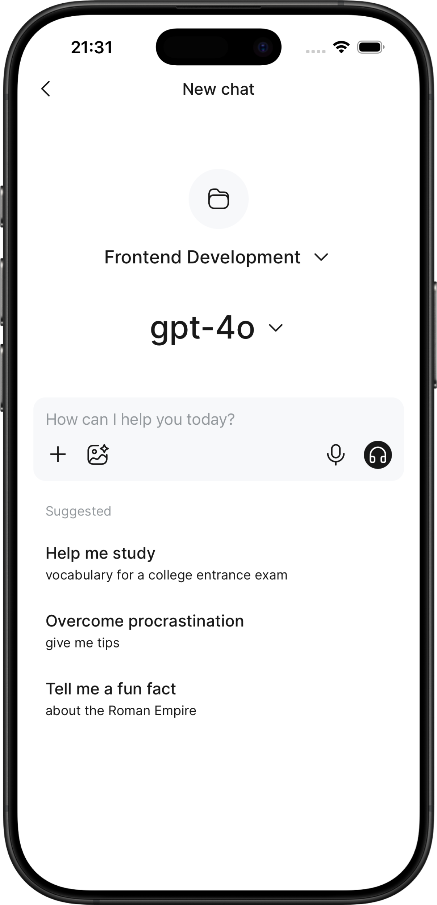
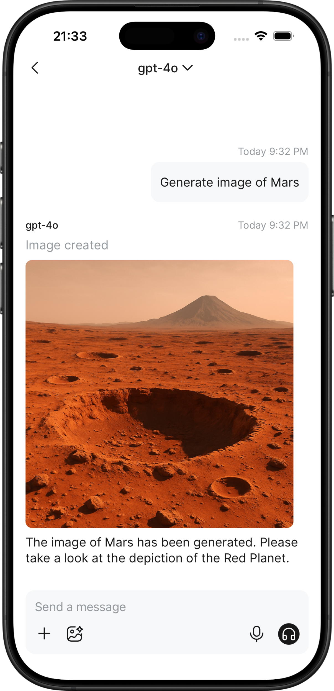
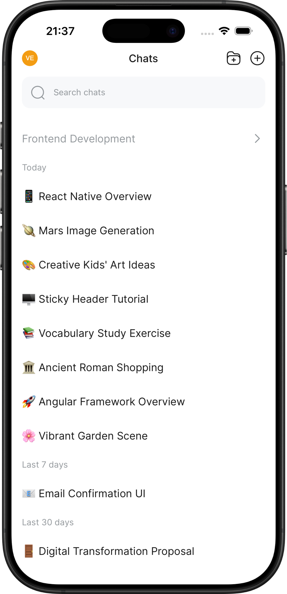

# Vertis

Vertis is a branded build of the Open MobileUI client. It retains the original GPL-3.0 license and Open WebUI compatibility.

**Professional mobile client for Open WebUI** – Access your self-hosted AI assistant anywhere, anytime

[Features](#-features) • [Installation](#-installation) • [Development](#️-development) • [Support](#-support) • [Privacy Policy](PRIVACY_POLICY.md)

 

**Vertis is being customized; installable builds are not published yet.**

---

## 📱 Overview

**Vertis** is a customized, cross-platform mobile client based on the open-source Open MobileUI project. It connects to [Open WebUI](https://github.com/open-webui/open-webui) and brings a self-hosted AI assistant to iOS and Android devices.

### Why Choose a Native Mobile App?

While Open WebUI works in mobile browsers, Vertis provides:

- ⚡ **Optimized Performance** – Native rendering and optimized React Native architecture deliver 60fps smooth interactions
- 🎯 **Mobile-First Design** – UI/UX crafted specifically for touch interactions, gestures, and mobile workflows
- 🔒 **Enhanced Security** – Secure credential storage and enterprise-grade authentication
- 📴 **Offline Capabilities** – Intelligent connection handling and graceful degradation when connectivity is limited
- 💼 **Enterprise Ready** – Built with professional architecture, comprehensive error handling, and maintainable codebase

  
  &nbsp;&nbsp;&nbsp;&nbsp;&nbsp;
  
  &nbsp;&nbsp;&nbsp;&nbsp;&nbsp;
  

---

## ✨ Features

### Core Functionality

- ✅ **Open WebUI Compatibility** – Support for all core Open WebUI features
- ✅ **Real-time Chat** – WebSocket-powered instant messaging with your AI assistant
- ✅ **Multi-Model Support** – Switch between different AI models seamlessly
- ✅ **Chat Management** – Organize conversations with folders, search, and archive functionality
- ✅ **Authentication** – Email/password and Google Sign-In support (requires additional setup)
- ✅ **Secure Connections** – Encrypted HTTPS/WSS connections to your self-hosted Open WebUI instance

### Mobile-Optimized Experience

- 📱 **Native Performance** – Smooth animations, responsive touch interactions, and optimized rendering
- 🎨 **Modern UI** – Clean, intuitive interface designed for mobile-first workflows
- 🔄 **Smart Sync** – Automatic synchronization with your Open WebUI instance
- 📸 **Media Support** – Image uploads, file attachments, and rich media handling
- 🌑 **AMOLED Dark Theme** – True-black backgrounds designed for OLED screens
- ⌨️ **Keyboard Optimization** – Intelligent keyboard handling and input management

### Coming Soon

- 🌍 **Internationalization** – Multi-language support
- 🎙️ **Voice Mode** – Hands-free voice input

---

## 🎯 Use Cases

- **Individuals** – An on-the-go AI assistant for instant answers without reaching for a laptop
- **Businesses** – Mobile access to company AI assistants for teams and field workers, with no per-user app licensing fees
- **Developers** – A well-architected, extensible React Native reference client for the Open WebUI ecosystem

## 📥 Installation

1. **Install the App** – Install a Vertis build when one is available.
2. **Launch the App** – Open the installed application
3. **Enter Server URL** – Provide your Open WebUI instance URL (e.g., `https://your-instance.com`)
4. **Authenticate** – Sign in with your Open WebUI credentials (email/password)
5. **Start Chatting** – You're ready to use your AI assistant on mobile!

## 🛠️ Development

### Tech Stack

This project is built with modern, industry-standard technologies:

- **[React Native](https://reactnative.dev/)** – Cross-platform mobile framework
- **[Expo](https://expo.dev/)** – Development platform and build tooling
- **[Nx](https://nx.dev/)** – Monorepo tooling for scalable architecture

### Architecture

The codebase follows a modular, scalable architecture:

- **Monorepo Structure** – Organized with Nx workspaces
- **Feature-Based Modules** – Clear separation of concerns
- **Shared Libraries** – Reusable components and utilities
- **Type Safety** – Full TypeScript coverage

### Building from Source

For detailed setup instructions — prerequisites, cloning, configuring your own Expo project, and running the app — see the [Contributing guide](CONTRIBUTING.md#development-setup).

## 🤝 Contributing

We welcome and appreciate contributions from the community! Whether you're fixing bugs, adding features, or improving documentation, your help makes this project better.

See [CONTRIBUTING.md](CONTRIBUTING.md) for how to report issues, set up your development environment, and submit a pull request.

---

## 🔗 Related Projects

- **[Open WebUI](https://github.com/open-webui/open-webui)** – The main Open WebUI project
- **[Open WebUI Documentation](https://docs.openwebui.com/)** – Official documentation and guides

---

## 💬 Support

### Community Support

- 📚 **Documentation**: Check this README and project docs
- 🐛 **Bug Reports**: [GitHub Issues](https://github.com/RonasIT/open-webui-react-native/issues)
- 💬 **Open WebUI Community**: [Open WebUI Discussions](https://github.com/open-webui/open-webui/discussions)

### Contact

For Vertis support, email [Yasuda](mailto:juaniecuenca07@gmail.com).

### Frequently Asked Questions

**Q: Is this app free to use?**
A: Yes — it's open source under GPL v3. Commercial use is allowed; see [License](#-license) for the terms.

**Q: Do I need to host my own Open WebUI instance?**
A: Yes, this app connects to your self-hosted Open WebUI deployment. See [Open WebUI Installation](https://docs.openwebui.com/) for setup instructions.

**Q: How do I report a security vulnerability?**
A: Please email security concerns directly to [Yasuda](mailto:juaniecuenca07@gmail.com) rather than opening a public issue.

---

## 🧩 Upstream

Vertis is an independent customization of the Open MobileUI client; upstream attribution and the GPL-3.0 license are retained.

---

## 📄 License

This project is licensed under the **GNU General Public License v3 (GPL v3)**.

**Note**: If you need to use this code in a proprietary application without GPL v3 obligations, please contact [Ronas IT](https://ronasit.com?utm_source=github&utm_medium=referral&utm_campaign=open_webui_react_native) to discuss alternative licensing options.

## 🔒 Privacy

Vertis is designed with privacy in mind. All your conversations and data remain on your self-hosted Open WebUI instance. We do not operate any backend services that receive, store, or process your chat content. For complete details about how we handle your information, please review our [Privacy Policy](PRIVACY_POLICY.md).

---

## 🙏 Acknowledgments

- **Open WebUI Team** – For creating an amazing open-source AI interface platform
- **React Native Community** – For the excellent framework and ecosystem
- **All Contributors** – Thanks to everyone who helps improve this project

---

**Vertis customized by Yasuda, based on [Open MobileUI](https://github.com/RonasIT/open-webui-react-native) by Ronas IT.**

_Open-source derivative; original project attribution and GPL-3.0 license are retained._

